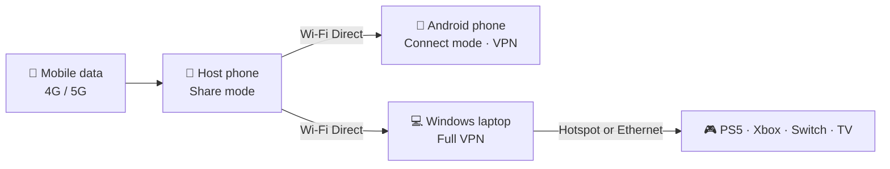

<div align="center">


# Hotspot Bypass VPN

**Share your phone's mobile data with every device. Skip the hotspot cap.**

Connect phones, laptops, PS5, Xbox, Switch and smart TVs to your Android phone over Wi-Fi Direct.<br>
Your carrier sees normal phone traffic, not tethering. Free, open source, no root.

[](https://github.com/nestchao/Hotspot-Bypass-VPN-Unlimited-Hotspot/releases/latest)
[](https://github.com/nestchao/Hotspot-Bypass-VPN-Unlimited-Hotspot/releases)
[](https://github.com/nestchao/Hotspot-Bypass-VPN-Unlimited-Hotspot/stargazers)
[](LICENSE)


### [🌐 Website](https://nestchao.github.io/Hotspot-Bypass-VPN-Unlimited-Hotspot/) · [⬇️ Download](https://nestchao.github.io/Hotspot-Bypass-VPN-Unlimited-Hotspot/download/) · [📖 Setup guide](https://nestchao.github.io/Hotspot-Bypass-VPN-Unlimited-Hotspot/guide/) · [❓ FAQ](https://nestchao.github.io/Hotspot-Bypass-VPN-Unlimited-Hotspot/faq/) · [🇨🇳 中文](https://nestchao.github.io/Hotspot-Bypass-VPN-Unlimited-Hotspot/zh/)

<br>


&nbsp;&nbsp;&nbsp;


<sub>Share mode on the phone with data (left) · Connect mode on another phone (right)</sub>

</div>

---

## Why Hotspot Bypass VPN?

Your plan says "unlimited data", but the hotspot is capped, throttled or blocked. Hotspot Bypass VPN skips Android's built-in tethering. The host phone opens a **Wi-Fi Direct** network and a local **SOCKS5 proxy**, so traffic from other devices leaves the phone as if the phone made it.

|  | Normal hotspot | Hotspot Bypass VPN |
|---|:---:|:---:|
| Counts against your hotspot allowance | Yes | No* |
| Root needed | No | No |
| Works for phones, laptops, consoles and TVs | Yes | Yes |
| Full VPN on Windows (games, every app) | n/a | Yes |
| UDP for games and voice chat | Yes | Yes |
| Price | Carrier add-on | **Free** |

<sub>*Results depend on how your carrier detects tethering. It works for most people, but no app can promise every carrier in every country.</sub>

## ✨ Features

- 📡 **Wi-Fi Direct sharing.** A direct phone-to-device link instead of Android's hotspot.
- 🎮 **Built for gaming.** UDP support for Roblox, Discord voice and other real-time traffic, with MTU tuned to 1350.
- 👥 **Many devices at once.** Up to 256 connections in total and 128 per device, so one busy client can't hog the host.
- 🔒 **Stays on when locked.** A foreground service and wake lock keep sharing alive with the screen off or the app swiped away.
- 💻 **Full VPN on Windows.** A virtual adapter (TUN) sends every app and game through the phone. No proxy settings needed.
- 📺 **Consoles and TVs.** The Windows client shares its connection to a PS5, Xbox, Switch or smart TV over Mobile Hotspot or an Ethernet cable.
- 🩺 **Self-healing.** The Windows client checks the connection every 15 seconds and recovers on its own.
- 🚫 **No root, no account, no ads.**

## 🧭 How it works



## 🚀 Quick start

> Full step-by-step instructions with troubleshooting: **[Setup guide](https://nestchao.github.io/Hotspot-Bypass-VPN-Unlimited-Hotspot/guide/)**

**1. Host phone (the phone with data)**
Install the APK, open **Share (Host)**, pick **5 GHz** for gaming, and tap **START SERVICE**. Allow battery optimization to be ignored so it keeps running.

| Wi-Fi name | Password | Proxy IP | Port |
|---|---|---|---|
| `DIRECT-HotspotBypass` | `87654321` | `192.168.49.1` | `8080` |

**2. Connect a device**

| Device | What to do |
|---|---|
| 📱 **Android phone** | Join the Wi-Fi above, open **Connect (Client)**, enter `192.168.49.1` and `8080`, then tap **START VPN**. |
| 💻 **Windows laptop** | Join the Wi-Fi, open the Windows client, enter the phone IP and SOCKS5 port, then click **Connect VPN**. |
| 🎮 **Console or TV** | Connect the laptop first. Under **Share with consoles & devices**, pick Wi-Fi Hotspot or Ethernet Cable, then click **Start Sharing Network**. On the console, leave IP and DNS automatic and the proxy off. |

## ⬇️ Download

| Platform | File | Requirements |
|---|---|---|
| **Android** (host and client) | [Hotspot-Bypass-VPN.apk](https://github.com/nestchao/Hotspot-Bypass-VPN-Unlimited-Hotspot/releases/latest/download/Hotspot-Bypass-VPN.apk) | Android 7.0+, Wi-Fi Direct |
| **Windows** installer | [HotspotBypassVPNSetup.exe](https://github.com/nestchao/Hotspot-Bypass-VPN-Unlimited-Hotspot/releases/latest/download/HotspotBypassVPNSetup.exe) | Windows 10/11 64-bit, admin rights |
| **Windows** portable | [Hotspot_Bypass_VPN_Windows.zip](https://github.com/nestchao/Hotspot-Bypass-VPN-Unlimited-Hotspot/releases/latest/download/Hotspot_Bypass_VPN_Windows.zip) | Extract fully before running |

SHA-256 hashes and the changelog are on the **[download page](https://nestchao.github.io/Hotspot-Bypass-VPN-Unlimited-Hotspot/download/)**.

> [!NOTE]
> Windows Defender may flag the Windows client as `Trojan:Win32/Wacatac.H!ml`. This is a machine-learning false positive: the client downloads helper files and changes routes and DNS, which looks like VPN hijacking. Verify the SHA-256 hash or run it from source. See [issue #11](https://github.com/nestchao/Hotspot-Bypass-VPN-Unlimited-Hotspot/issues/11).

## ❓ FAQ

<details>
<summary><b>Do I need root?</b></summary>

No. The app uses only the standard Android VpnService and Wi-Fi Direct APIs.
</details>

<details>
<summary><b>How fast is it? Is it good for gaming?</b></summary>

Usually 10–40 Mbps, depending on signal, distance and band. UDP is supported, and it typically adds 30–60 ms on top of the phone's own ping. Use 5 GHz and keep the devices close.
</details>

<details>
<summary><b>Can my PS5 connect straight to the phone?</b></summary>

No. Consoles can't run the app or use a SOCKS5 proxy, so they go through the Windows client's sharing. That adds about 5–15 ms.
</details>

<details>
<summary><b>Connected, but pages won't load?</b></summary>

Set **Private DNS** on the client phone to Off or Automatic, then reconnect the VPN.
</details>

More answers: **[full FAQ](https://nestchao.github.io/Hotspot-Bypass-VPN-Unlimited-Hotspot/faq/)**

## 🛠️ Build from source

**Android app**
```bash
git clone https://github.com/nestchao/Hotspot-Bypass-VPN-Unlimited-Hotspot.git
cd Hotspot-Bypass-VPN-Unlimited-Hotspot
./gradlew assembleDebug
```

**Windows client** (Python)
```bash
cd laptop_proxy
pip install -r requirements.txt
python main.py          # run as Administrator
build_exe.bat           # optional: build the portable package
```

**Website** (Astro)
```bash
cd website
npm install
npm run dev
```

<details>
<summary><b>Technical details</b></summary>

| Area | Implementation |
|---|---|
| Bypass method | SOCKS5 proxy on the host, reached over Wi-Fi Direct |
| Android client | `VpnService` + tun2socks, MTU 1350 |
| Persistence | Foreground service, WakeLock, AlarmManager restart |
| Connection limits | 256 total, 128 per client IP; 10-minute TCP and 5-minute UDP idle cleanup; 64 KB pipe buffers |
| Windows client | CustomTkinter UI, Wintun + tun2socks virtual adapter, health check every 15 s |
| Console sharing | Windows Internet Connection Sharing to Mobile Hotspot or a chosen Ethernet adapter; previous sharing settings are restored on stop |

</details>

## 🤝 Contributing

Bug reports, ideas and pull requests are welcome. When reporting a problem, include your phone model, Android or Windows version, and the app's debug log.

- 🐛 [Report a bug](https://github.com/nestchao/Hotspot-Bypass-VPN-Unlimited-Hotspot/issues/new)
- 💬 [Browse issues](https://github.com/nestchao/Hotspot-Bypass-VPN-Unlimited-Hotspot/issues)

If this app saved your data plan, consider giving it a ⭐. It helps other people find it.

## ⚖️ Disclaimer

Sharing your connection is legal in most countries, but your carrier's terms may forbid tethering. You're responsible for how you use this app.

## 📄 License

[MIT](LICENSE) © 2026 nestchao
